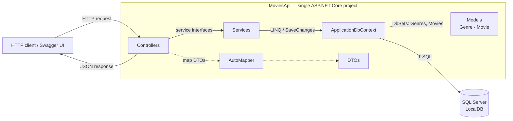

# MoviesApi

A small ASP.NET Core Web API for managing movies and genres. This is a learning/portfolio project built with .NET 10, Entity Framework Core, SQL Server, and AutoMapper.

**Stack:** ASP.NET Core 10 · EF Core 10 (SQL Server / LocalDB) · AutoMapper 16 · Swashbuckle (Swagger UI)

## Architecture Overview

The project is a **single ASP.NET Core Web API project with a simple layered structure**:

```text
Controllers  →  Services  →  ApplicationDbContext (EF Core)  →  SQL Server
```

### Components

| Component | Location | Responsibility |
| --- | --- | --- |
| **Controllers** | `MoviesApi/Controllers` | Expose the `/api/genres` and `/api/movies` endpoints. They bind request data, call the service interfaces, and return `IActionResult` responses. `MoviesController` also validates poster uploads and uses AutoMapper to return `MovieDetailsDto`. |
| **Services** | `MoviesApi/Services` | `GenresService` and `MoviesService` implement `IGenresService` and `IMoviesService`. They run the EF Core queries and persist changes, and they work with entities rather than DTOs. `GenresService.TryDeleteAsync` blocks deleting a genre that still has movies. |
| **Models** | `MoviesApi/Models` | `Genre` and `Movie` are the EF Core entities. A movie belongs to one genre through `Movie.GenreId`; a genre can have many movies. |
| **DTOs** | `MoviesApi/Dtos` | `GenreDto` and `MovieDto` are the write contracts; `MovieDetailsDto` is the movie read contract and adds `GenreName`. Movie endpoints map to/from DTOs; the genre GET endpoint currently returns `Genre` entities directly. |
| **Data access** | `MoviesApi/Data/ApplicationDbContext.cs` | Exposes `DbSet<Genre>` and `DbSet<Movie>`. `OnModelCreating` configures the movie → genre relationship with `DeleteBehavior.Restrict`. There is no repository or unit-of-work layer. |
| **Entity Framework Core** | `MoviesApi/Migrations` | Maps the entities to the `Genres` and `Movies` tables, translates LINQ into T-SQL, tracks changes, and persists them on `SaveChangesAsync`. Migrations keep the database schema in sync. |
| **Mapping** | `MoviesApi/Helpers/MappingProfile.cs` | AutoMapper profile with `Movie → MovieDetailsDto` (including `Genre.Name → GenreName` by convention) and `MovieDto → Movie` (the poster is ignored and assigned separately in the controller). |
| **Application setup** | `MoviesApi/Program.cs` | Registers the `DbContext`, services, AutoMapper, controllers, and Swagger, and configures the HTTP request pipeline. |

### Request flow

A read request such as `GET /api/movies/5`:

1. The request reaches `MoviesController.GetByIdAsync`.
2. The controller calls `IMoviesService.GetById(5)`. ASP.NET Core resolves `MoviesService` through dependency injection.
3. `MoviesService` queries `ApplicationDbContext.Movies` with `Include(m => m.Genre)`. EF Core translates the LINQ query to SQL and sends it to SQL Server.
4. SQL Server returns the row, and EF Core materializes a `Movie` entity with its `Genre`.
5. The controller maps the entity to `MovieDetailsDto` with AutoMapper and returns `200 OK` with JSON. If no row exists, it returns `404 Not Found`.

Write requests follow the same path in reverse:

- `POST /api/movies` binds a multipart `MovieDto`, validates the poster (`.jpg`/`.png`, max 1 MB) and the genre in the controller, maps it to `Movie`, and calls `IMoviesService.Add`, which inserts the row.
- `DELETE /api/genres/{id}` calls `GenresService.TryDeleteAsync`. If movies still reference the genre, the service returns `false` and the controller responds `409 Conflict`.

### Diagram



Dashed lines are in-memory object mapping; solid lines are runtime calls or data access.

### Dependency Injection

Registrations in `Program.cs`:

```csharp
builder.Services.AddDbContext<ApplicationDbContext>(options =>
    options.UseSqlServer(connectionString));

builder.Services.AddTransient<IGenresService, GenresService>();
builder.Services.AddTransient<IMoviesService, MoviesService>();

builder.Services.AddAutoMapper(cfg => { }, typeof(Program));
```

- `AddDbContext` registers `ApplicationDbContext` with the scoped lifetime.
- Both services are registered as **transient**. Within one HTTP request, the controller's service instances share the same scoped `ApplicationDbContext`.
- Controllers receive their dependencies through constructor injection: `MoviesController(IMoviesService, IGenresService, IMapper)` and `GenresController(IGenresService)`. Services receive `ApplicationDbContext` the same way.
- AutoMapper scans the assembly that contains `Program`, which finds `MappingProfile`.

## Running locally

Requirements: .NET 10 SDK and SQL Server LocalDB (the connection string is in `MoviesApi/appsettings.json`).

```bash
dotnet tool install --global dotnet-ef   # once, if dotnet-ef is not installed
dotnet ef database update --project MoviesApi
dotnet run --project MoviesApi
```

Alternatively, run `Update-Database` from the Visual Studio Package Manager Console.

Swagger UI is available in Development at `https://localhost:7187/swagger`.
