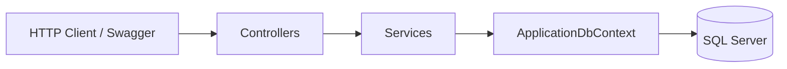

# MoviesApi

## Technology Stack

- ASP.NET Core Web API
- .NET 10
- Entity Framework Core
- SQL Server (LocalDB)
- AutoMapper
- Swagger / OpenAPI

## Short Description

A REST API for managing movies and genres. It supports full CRUD operations, movie poster uploads, and filtering movies by genre.

## Main Features

- List, create, update, and delete genres.
- List all movies, view a movie by ID, and filter movies by genre.
- Create, update, and delete movies.
- Upload a movie poster (`.jpg` or `.png`, up to 1 MB).
- Validate that each movie references an existing genre.
- Prevent deleting a genre that still has movies (`409 Conflict`).
- Movie read endpoints return DTOs that include the genre name (AutoMapper).
- Explore and test the API with Swagger UI in Development.

## Architecture Overview

The API is a single ASP.NET Core project with a simple layered structure:

`Controllers → Services → ApplicationDbContext (EF Core) → SQL Server`

- **Controllers** handle HTTP requests and responses.
- **Services** contain the data operations and use `ApplicationDbContext` directly.
- **Models** (`Genre`, `Movie`) are the EF Core entities.
- **DTOs** define the request and response shapes; AutoMapper maps movie data.
- **Data access** uses `ApplicationDbContext` with EF Core and SQL Server.



## Getting Started

Prerequisites: .NET 10 SDK and SQL Server LocalDB.

From the repository root:

```bash
dotnet restore
dotnet run --project MoviesApi --launch-profile https
```

The API uses the `DefaultConnection` connection string in `MoviesApi/appsettings.json`. If the database does not exist yet, apply the included migrations (requires the `dotnet-ef` tool):

```bash
dotnet tool install --global dotnet-ef   # if not already installed
dotnet ef database update --project MoviesApi
```

In Visual Studio, you can also run `Update-Database` from the Package Manager Console.

Swagger UI is available in Development at `https://localhost:7187/swagger`. The URL comes from the `https` profile in `MoviesApi/Properties/launchSettings.json`; the `http` profile uses port `5128`.
